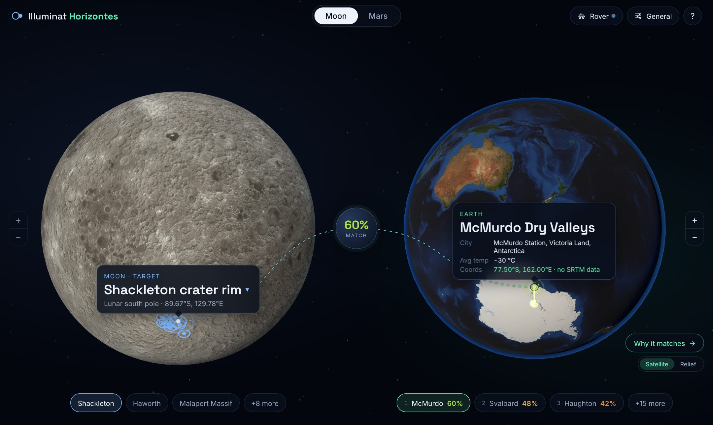
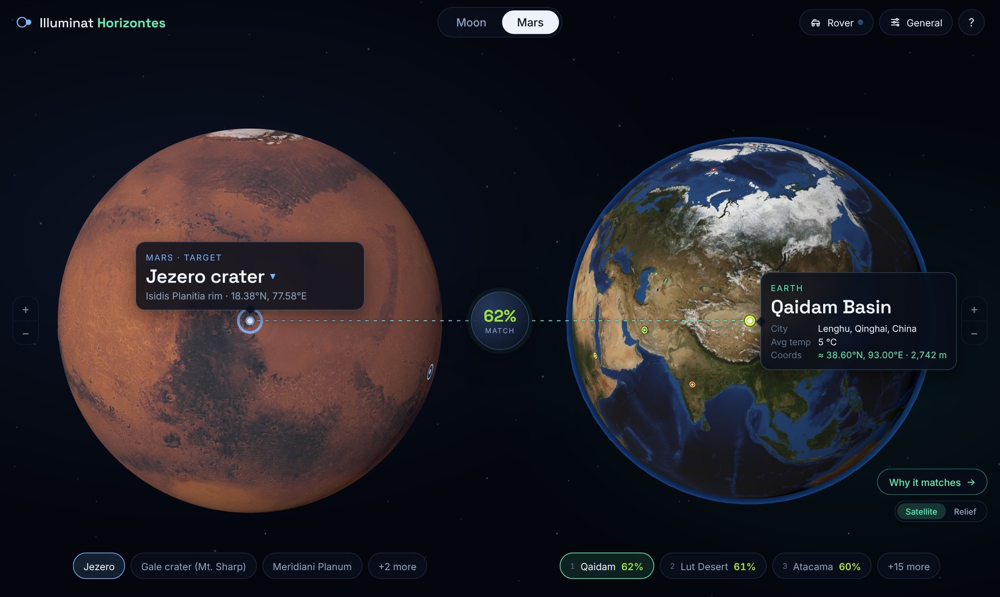
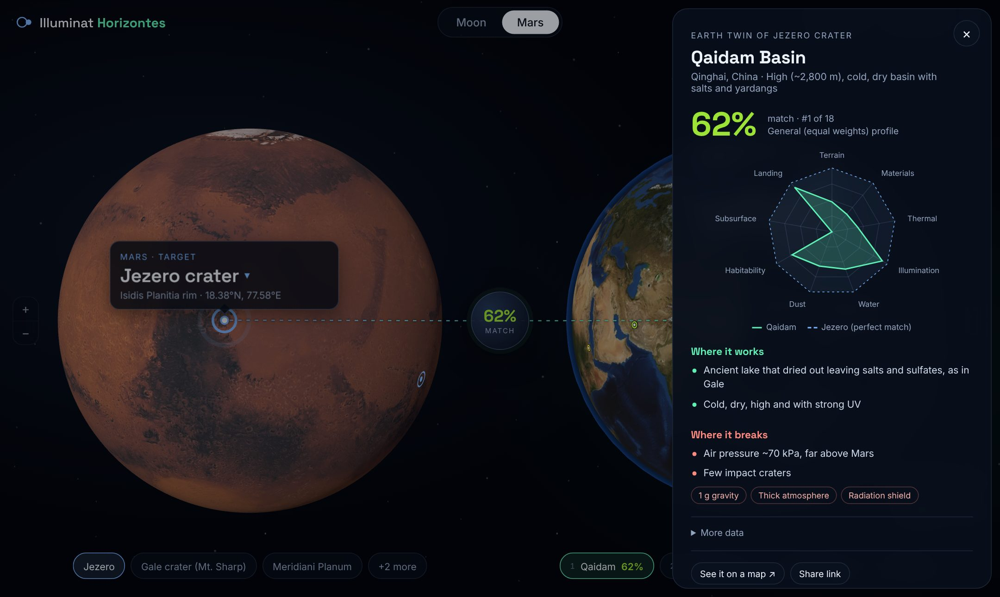

# Illuminat Horizontes

**Where on Earth can we train for the Moon and Mars?**

Our entry for the NASA Space Apps Challenge 2026, challenge *Identify Earth Locations that Analog the Permanent Moon Base Locations and Mars*.

We compare **18 places on Earth** with **16 targets on the Moon and Mars** across **9 dimensions** and give every pair a similarity score from 0 to 100. For each place we say where the analogy holds, where it breaks, and what you could actually test there. A small Arduino rover takes live readings in the field and puts them next to the NASA data.

**Live site:** https://lucaslopes-ti.github.io/iluminat-NasaChallenge/
**Demo (slides):** https://canva.link/0sw8fdnj7fn8epy



| Mars: Jezero vs. its closest Earth twin | Click the score: why it matches, and where it breaks |
|---|---|
|  |  |

## The idea

Analog sites like Atacama or Haughton Crater are great, but they were picked mostly by experience, and nobody can say *how* good an analog they are, or for *what*. We wanted a number you can argue with.

- **Earth sites (18):** the classic analogs (Atacama, Haughton, Mauna Kea, Río Tinto, McMurdo Dry Valleys) plus places that get little attention, including eight in Brazil: Lençóis Maranhenses, Raso da Catarina, Gilbués, Serra da Cangalha, Araguainha, Vargeão, Vista Alegre and the Carajás iron caves. Also Qaidam Basin, Lut Desert, Dallol, Svalbard and Lonar.
- **Targets (16):** the nine Artemis III candidate regions, Shackleton, a Marius Hills skylight, and Jezero, Gale, Meridiani, Arcadia and Oxia on Mars.
- **Dimensions (9):** terrain, surface materials, temperature, illumination, water and ice, dust and wind, habitability, subsurface, landing and mobility.
- **Mission profiles (6):** general, rover testing, astrobiology, ice/ISRU, base construction, solar power. Each one weights the dimensions differently, so the same place can rank high for a rover test and low for astrobiology.

### How the score works

Every numeric indicator (slope, roughness, day/night temperature, sun elevation, dust optical depth, pressure...) becomes a similarity

```
S = exp( -(earth - target)^2 / (2 σ^2) )
```

with one σ per indicator, chosen so that "half as similar" means something physical (σ values in `dados/essenciais/entrada/dimensoes.json`). Categorical traits like geology, ice or caves are tags compared with Jaccard. A dimension is the mean of its indicators, and the final score is the profile-weighted mean of the dimensions.

Some things never match and we say so on every site: **gravity, atmosphere, radiation and day length.**

### Results (general profile)

| # | Earth site | Score | Best target |
|---|---|---|---|
| 1 | Qaidam Basin, China | 68 | Oxia Planum |
| 2 | Lut Desert, Iran | 66 | Oxia Planum |
| 3 | Atacama, Chile | 66 | Oxia Planum |
| 4 | McMurdo Dry Valleys, Antarctica | 65 | Peak near Cabeus B |
| 5 | Dallol, Ethiopia | 59 | Meridiani Planum |
| 7 | **Lençóis Maranhenses, Brazil** | 55 (77 for rover tests) | Meridiani Planum |

**Sanity check.** If the method is any good, the well-known analogs should rank high for the target the literature links them to. Out of 18 sites they come in at: Haughton 2nd, Atacama 3rd, Mauna Kea 4th, Río Tinto 6th, Dry Valleys 6th. That gives some confidence to the new sites that show up next to them, like Qaidam, Lut and Lençóis.

## How it fits together

```
 NASA + Copernicus data ──> dados/essenciais/gerar_dados.py ──> score for every site × target
                                                                  │
                         ┌────────────────────────────────────────┼─────────────────────┐
                         v                                        v                     v
                three.js site (web/)                  C terminal app (Projeto_C)   per-site MQTT messages
                         ^                                        ^
                         └───────────── MQTT ─────────────────────┤
                                                                  │
   sensors ─> Arduino Uno ─> USB cable ─> ponte_serial_mqtt.py / controle_carrinho.py (laptop)
```

1. **Data:** Python scripts pull Earth data from NASA services, combine it with published Moon and Mars values and write the scores to JSON and CSV.
2. **Site:** two globes side by side (Moon or Mars on the left, Earth on the right). Pick a target, see the ranked Earth analogs, click the score for the radar chart and the "works / breaks" list.
3. **Rover:** an Arduino reads air temperature, humidity, distance to obstacles and light. It talks to a laptop over USB. A small Python bridge forwards each reading to MQTT, and both the site (**Web** button) and the C app show it live next to the Earth site and the target. The site can also read the rover directly over USB (Web Serial, Chrome/Edge).
4. **C app:** a terminal program for the team's laptop: choose Moon or Mars, a target, see the top 3 analogs, open a site, then drive the rover and watch its sensors.

## Running it

**Site**, any static server:

```
cd web
python3 -m http.server 8000      # then open http://localhost:8000
```

**Regenerate the data** (only needs numpy):

```
pip3 install numpy
python3 dados/essenciais/gerar_dados.py      # scores from dados/essenciais/entrada/
python3 dados/essenciais/gerar_mqtt.py       # MQTT messages per site
python3 web/tools/gerar_dados_site.py        # English data for the site
```

The download scripts (NASA POWER, MOD13C2, Copernicus DEM, MODIS via ORNL DAAC, AppEEARS) are described in [dados/essenciais/README.md](dados/essenciais/README.md).

**Rover:**

```
arduino-cli compile --fqbn arduino:avr:uno firmware/carrinho_motores
arduino-cli upload  -p <port> --fqbn arduino:avr:uno firmware/carrinho_motores
pip install pyserial paho-mqtt
python3 firmware/ponte_serial_mqtt.py --porta <port> --baud 9600 --local lencois
```

Then open the site, scroll to **Field rover** and press **Web**. Wiring and protocol are in [firmware/README.md](firmware/README.md).

**C app:** open `Projeto_C/NasaSpace/NasaSpace.cbp` in Code::Blocks, or run `./bin/Debug/nasaspace <port> 9600`. It needs Mosquitto (`mosquitto_pub`, `mosquitto_sub`) on the PATH.

## Data sources

Earth data comes only from NASA and Copernicus. Every value in the dataset carries a **status** (measured, calculated, reference, provisional) and a **source** (product, version, DOI, resolution, access date), listed in `dados/essenciais/entrada/fontes.csv`.

| What | Product | Source |
|---|---|---|
| Elevation, relief, slope, roughness, flat area | SRTMGL30 v002 (doi:10.5067/MEaSUREs/SRTM/SRTMGL30.002) | NASA LP DAAC |
| Antarctic relief (Dry Valleys) | Copernicus DEM GLO-90 | ESA / Copernicus |
| Day (~13:30) and night (~01:30) surface temperature | MYD11A2 v061, 1 km, 2024 | NASA Aqua MODIS via ORNL DAAC |
| Vegetation (NDVI) | MOD13C2 v061, 2020–2025 | NASA Terra MODIS, LP DAAC |
| Air temperature, rain, dust (AOD 550 nm), wind, albedo | NASA POWER (MERRA-2, CERES), 2001–2025 means | NASA Langley |
| Moon terrain, illumination, temperature | LRO LOLA, LRO Diviner, LROC | NASA |
| Mars terrain, albedo, pressure, temperature | MGS MOLA and TES, Mars 2020 MEDA, MSL REMS, MER Mini-TES, MRO MCS, CRISM, SWIM/SHARAD | NASA |
| Artemis III regions | NASA (Oct 2024), USGS/IAU Gazetteer of Planetary Nomenclature, LPSC 2025 abstracts | |

Globe textures: NASA Blue Marble, NASA SVS CGI Moon Kit (LROC + LOLA), NASA 3D Resources (Mars) and our own SRTM30 relief. Full credits in [web/README.md](web/README.md). In numbers: 288 site–target pairs built on 800 values (305 measured by satellite or model, 247 published by missions, the rest calculated or referenced) and 167 tags backed by 25 papers.

## Where the analogy breaks (and where our data is weak)

- Gravity, vacuum or thin CO₂ atmosphere, radiation and day length can't be reproduced anywhere on Earth. These show up on every site.
- NASA POWER cells are about 50 km wide, so small or steep sites mix with their surroundings. On Mauna Kea the air temperature comes out roughly 20 °C warmer than the summit.
- Moon and Mars numbers are published values, not data we processed pixel by pixel.
- Some Artemis III region centers are approximate (on the rim or plateau of the named feature), because NASA only published them as a map.
- Mars pressure is one measurement (MEDA at Jezero) adjusted by MOLA altitude, without seasonal change.
- One value is still provisional: NDVI for the Dry Valleys, which MOD13C2 doesn't cover (set to 0, polar desert).

## Repository layout

| Folder | What's inside |
|---|---|
| [`web/`](web/) | The site (three.js, no build step). |
| [`dados/essenciais/`](dados/essenciais/) | Input data, scoring script and outputs (`analogos_completo.json`, CSVs, MQTT messages). |
| [`dados/srtm30/`](dados/srtm30/), [`dados/copernicus_dem/`](dados/copernicus_dem/), [`dados/mola/`](dados/mola/) | Raw tiles and caches used by the scripts. |
| [`firmware/`](firmware/) | Arduino sketches and the USB → MQTT bridge. |
| [`Projeto_C/NasaSpace/`](Projeto_C/NasaSpace/) | The C terminal app (Code::Blocks). |
| [`docs/`](docs/) | Project plan, screenshots and a [Portuguese version of this README](docs/README.pt-BR.md). |
| `Site/` | A separate site built by other team members. |

Most code comments and folder names are in Portuguese; the site itself is in English.

## Use of AI

We used AI coding assistants (Claude Code and Google Antigravity) to help write and review parts of the site, the data scripts, the C app and this documentation. `AGENTS.md` and `CLAUDE.md` are the context files we gave those assistants. The idea, the choice of sites and targets, the scoring method, the hardware and the decisions about data sources are the team's, and every number in the dataset points back to a NASA or Copernicus source that can be checked.

## Team

Illuminat Horizontes, NASA Space Apps Challenge 2026.
